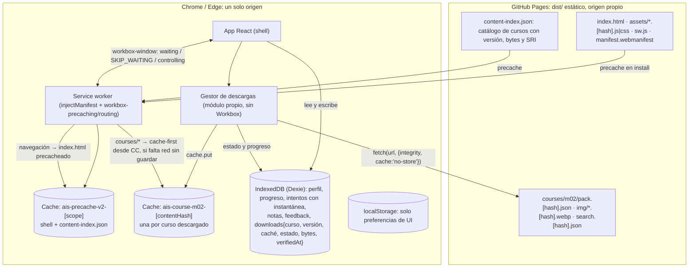
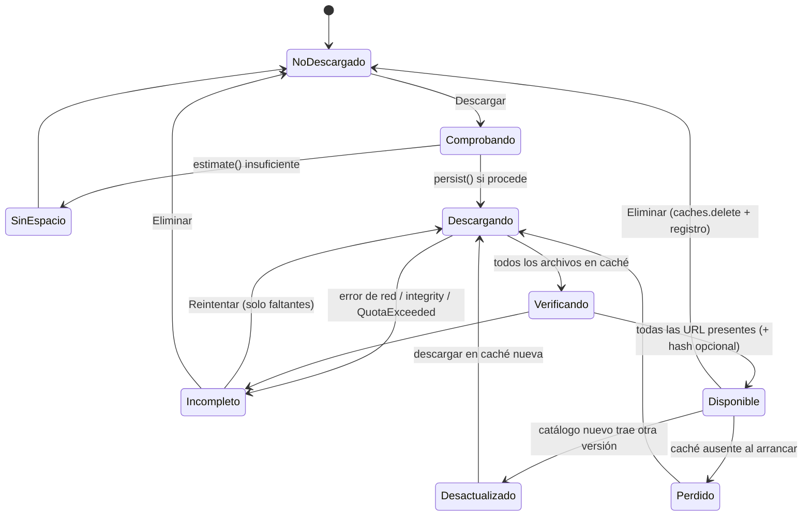
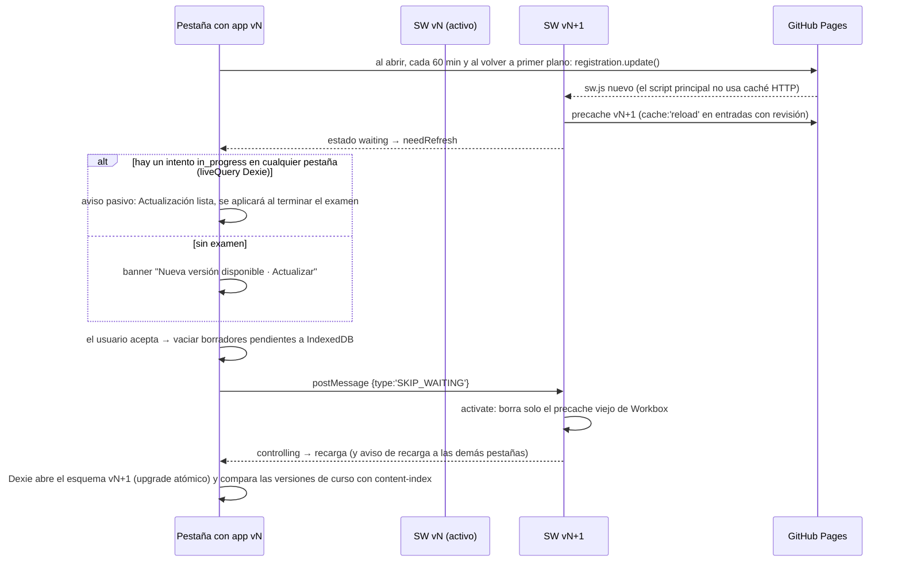

# Investigación: stack técnico para la V1 de la PWA

**Fecha de verificación:** 2026-10-21 · **Alcance:** plan.md §1, §3, §8, §9, §13 y §17.4 · **Método:** registro npm (metadatos de cada paquete), notas de versión y repositorios de GitHub, documentación oficial y una observación propia de encabezados HTTP de GitHub Pages con `curl`. No se instaló nada ni se creó ningún proyecto.

Convenciones: las versiones son las que estaban publicadas como `latest` el 2026-10-21, junto con su fecha de publicación. **[inferencia]** marca conclusiones propias que ninguna fuente afirma tal cual. Los IDs `src-…` remiten al registro de fuentes (§5).

---

## 1. Resumen ejecutivo

1. **Núcleo:** React 19.3.1 + Vite 8.3.x (Rolldown) + `@vitejs/plugin-react` 6.1.2 + **TypeScript 6.0.3**, no 7.0. TS 7 no tiene API programática y `typescript-eslint` admite solo `<6.1`. La plantilla oficial `create-vite` también fija `~6.0.3`. Para el build se usa **Node 24 LTS** (24.22.1); Node 26 pasa a LTS el 2026-10-28.
2. **PWA:** `vite-plugin-pwa` 2.0.0 con estrategia `injectManifest` sobre Workbox 7.4.1 y `registerType: 'prompt'`. El *shell* va precacheado. Cada curso se descarga en su propia caché (`ais-course-<id>-<hash>`) con `fetch(..., { integrity })` (SRI), y su estado vive en IndexedDB.
3. **Persistencia:** Dexie 4.4.6 (migraciones declarativas con rollback), más `navigator.storage.persist()`/`estimate()`. Una falta de espacio se trata como error recuperable.
4. **Rutas:** React Router 8.5 en *Data Mode* con `createHashRouter`, sin el truco de `404.html`. `useBlocker` protege los exámenes.
5. **Contenido:** Markdown → HTML saneado en build con unified/remark/rehype. Zod 4.6 valida el contenido y también las importaciones. Para buscar se usa MiniSearch 7.2 con *stemmer* español y plegado de acentos.
6. **Pruebas:** Vitest 5.0 + Testing Library + `fake-indexeddb`. Playwright 1.64 (Chromium) cubre el SW y el modo offline, y `@axe-core/playwright` 4.14 la accesibilidad.
7. **Reporte HTML:** se construye con el DOM y `textContent`. El JSON va en `
<pre>` (el serializador HTML lo escapa) y una CSP `<meta>` impide ejecutar scripts.
8. **GitHub Pages cumple lo necesario:** HTTPS, SW con alcance en el subpath, `.webmanifest` con su MIME correcto. No admite encabezados propios (todo sale con `max-age=600`).
9. **Hallazgo crítico:** `dponch-00.github.io` ya aloja Python GO y MKompact, y los SW de ambas apps **borran toda caché ajena del mismo origen**. Antes de la Fase 0 hay que publicar AI School en un **origen propio**: una organización gratuita con `<org>.github.io` o un subdominio.

---

## 2. Tabla de decisión por capa

| Capa | Recomendación | Versión verificada (fecha) | Alternativa | Por qué | Riesgo |
| --- | --- | --- | --- | --- | --- |
| Entorno de build | Node.js 24 LTS "Krypton" | 24.22.1 (publicada 2026-10-20; verificado 2026-10-21) | Node 26 (Active LTS desde 2026-10-28) | Cumple los `engines` de todas las dependencias elegidas (§2.1). Daniel ya tiene 24.17.0 instalado. | Node 24 entró en *maintenance* el 2026-10-20 (fin de vida 2028-04-30). Conviene planear el paso a 26 en 2027. |
| UI | React + react-dom | 19.3.1 (2026-10-14) | — | Estándar del plan. Los parches 19.x del 2026-10-14 solo tocan React Server Components, que esta SPA no usa [inferencia]. | Bajo. No adoptar RSC ni APIs de servidor. |
| Lenguaje | TypeScript 6.0.x | 6.0.3 (2026-04-16). Existe 7.0.2 (2026-07-08) y 7.1.0-beta (2026-10-20) | TS 7 solo para `tsc` vía alias `@typescript/native`, con TS 6 para el resto de herramientas | TS 7.0 no trae API y `typescript-eslint` 8.72 exige `typescript <6.1.0`. `create-vite` 9.3.1 fija `~6.0.3`. | TS 7.1 (con API nueva) espera RC hacia noviembre. Revisar la migración cuando las herramientas la soporten. |
| Build | Vite 8.3 + `@vitejs/plugin-react` | Vite 8.3.5 (2026-10-21); plugin 6.1.2 (2026-10-05, peer `vite ^8`) | Vite 7.3.x (rama aún parcheada: 7.3.7, 2026-10-06) | Plantilla oficial. Rolldown + Oxc. El `build.target` por defecto es Baseline (Chrome/Edge 111+), suficiente para Chrome Android y Chrome/Edge de escritorio. | 8.3.5 salió el mismo día de esta verificación: fijar con lockfile. Con Rolldown, `injectManifest` muestra un aviso de deprecación (`inlineDynamicImports`), que es inocuo. |
| Lint | oxlint (el que trae la plantilla) | 1.89.0 (2026-10-19) | ESLint 10.13.0 + `typescript-eslint` 8.72.0 | Es lo que trae `create-vite` y no depende de la API de TS. | Menos reglas y menos madurez que ESLint [inferencia]. Si se elige ESLint, queda atado a TS <6.1. |
| PWA (generación del SW) | `vite-plugin-pwa`, `strategies: 'injectManifest'`, `registerType: 'prompt'` | 2.0.0 (2026-10-03). Peers: `vite` hasta `^8`, `workbox-build`/`workbox-window ^7.4.1`. Node ≥20.19 | Serwist 9.5.13 (`@serwist/vite`, peer `vite >=5`) o un SW escrito a mano | Integra Vite 8, precache con revisiones, hook React `useRegisterSW` y una opción de emergencia `selfDestroying`. | El mantenedor prepara un fork de Workbox (`@vite-pwa/workbox`) y un `@vite-pwa/core` modular, así que habrá una migración futura. Hay 191 issues abiertos. |
| Runtime del SW | Workbox (`workbox-precaching`, `workbox-routing`) | 7.4.1 (2026-05-04) | Serwist | Probado en producción. Admite `integrity` por entrada y usa `cache: 'reload'` para entradas con revisión, lo que evita la caché HTTP de 10 min de Pages. | Mantenimiento mínimo: las versiones 7.4.x solo actualizan dependencias. El dueño actual es el equipo Aurora de Chrome. |
| Hosting | GitHub Pages con Actions, **en origen propio**: organización gratuita, sitio `<org>.github.io`, `base: '/'` | Documentación y encabezados verificados el 2026-10-21 | `dponch-00.github.io/<repo>/`, solo si se corrigen antes los SW de Python GO y MKompact. Si no hay otra vía, Cloudflare Pages o Netlify | HTTPS automático, gratis, flujo ya conocido por Daniel. Ninguna función de la V1 necesita encabezados propios. | Sin encabezados propios. `max-age=600` fijo. En plan Free el repo tiene que ser público. El origen elegido es definitivo, porque cambiarlo exige exportar e importar. |
| Router | React Router 8, *Data Mode*, `createHashRouter` | 8.5.0 (2026-10-19). Peer `react >=19.2.7`; Node ≥22.22 | TanStack Router 1.170.45 con `createHashHistory` | Sin reescrituras de servidor, *fallback* offline trivial (solo `index.html`) y `useBlocker` para exámenes. | Una versión mayor por año (v9 hacia 2027). Solo ESM. Con *hash routing*, las anclas `#id` dentro de las lecciones dejan de funcionar. |
| Persistencia | Dexie 4 + `dexie-react-hooks` | Dexie 4.4.6 (2026-09-10); hooks 4.4.0 (2026-03-18) | `idb` 8.0.4 (2026-10-06, ~1,19 kB brotli) | Versionado declarativo con *upgrades* que revierten si fallan, cierre automático ante `versionchange` y consultas reactivas. | 584 issues abiertos. Dentro de una transacción no se puede esperar a `fetch` u otras API asíncronas. |
| Cuota y persistencia | `navigator.storage.persist()`, `persisted()`, `estimate()` | API estable (MDN consultado 2026-10-21) | — | Chrome decide sin mostrar diálogo, según la interacción del usuario con el sitio (instalado, marcador, *engagement*). | Puede negarse. `estimate()` es aproximado. El desalojo es por origen y completo. |
| Pipeline Markdown | unified: `remark-parse` → `remark-gfm` → `remark-rehype` → `rehype-sanitize` → `rehype-stringify`, en un script de build | unified 11.0.5; remark-parse 11.0.0; remark-gfm 4.0.1; remark-rehype 11.1.2; rehype-sanitize 6.0.0; rehype-stringify 10.0.1 | markdown-it 15.0.3 (2026-10-16) | El AST permite validar enlaces, imágenes e IDs, generar índices y sanear. | Ecosistema estable con pocas versiones recientes. Solo ESM. |
| Front matter | `yaml` (+ `vfile-matter`) | yaml 2.9.1 (2026-09-11); vfile-matter 5.0.1 | gray-matter 4.0.3 (sin versión nueva desde 2021) | Mantenido y compatible con unified. | Bajo. |
| Validación | Zod 4 (un esquema para el build y para las importaciones) | 4.6.7 (2026-10-12) | Valibot 1.5.0; Ajv 8.20.0 con código *standalone* | El mismo esquema valida contenido, respaldos y el JSON del reporte. `z.toJSONSchema()` (draft 2020-12) sirve para documentar el contrato a Codex. | Tamaño en el cliente: medir y usar `zod/mini` si hace falta. |
| Búsqueda offline | MiniSearch + `@orama/stemmers/spanish` + plegado de diacríticos en `processTerm` | MiniSearch 7.2.0 (2025-09-16); @orama/stemmers 3.1.18 | Pagefind 1.5.2 (*stemming* en español nativo, pensado para HTML estático); FlexSearch 0.8.212 | Índice en memoria que se serializa (`toJSON`/`loadJSON`) y viaja dentro del paquete de cada curso. | No publica versión desde hace 13 meses. La calidad del *stemming* combinado no está probada [inferencia]. |
| Pruebas unitarias y de componentes | Vitest 5 + jsdom + Testing Library + `fake-indexeddb` | vitest 5.0.5 (2026-10-15); jsdom 30.1.3; @testing-library/react 16.3.3; user-event 14.6.8; jest-dom 7.0.1; fake-indexeddb 6.2.6 | happy-dom 21.0.4; Vitest Browser Mode (`@vitest/browser-playwright` 5.0.5) | Mismo *pipeline* que Vite. Las migraciones de Dexie se prueban sin navegador. | Vitest 5 cambió valores por defecto (mocks, matchers estrictos, rutas `.vitest/`). |
| E2E, SW y offline | Playwright (Chromium) contra `vite build` + `vite preview` con la misma `base` | @playwright/test 1.64.1 (2026-10-14) | — | El soporte de SW es solo para Chromium, que coincide con los navegadores objetivo. `context.route()` ve las peticiones del SW. | `setOffline` con SW tuvo fallos históricos. Las peticiones del script SW actualizado no se pueden enrutar. |
| Accesibilidad | `@axe-core/playwright` en E2E + revisión manual | axe-core 4.14.0 (2026-10-05); @axe-core/playwright 4.14.0 (2026-10-15) | `vitest-axe` (no recomendado: 0.1.0 de 2022) | Integración directa con los recorridos E2E. | Según Deque detecta en promedio un 57 % de los problemas WCAG. El resto exige revisión manual. |
| Reporte HTML | Generador propio con DOM + `textContent`, JSON en `
<pre>` y CSP `<meta>` sin scripts | HTML Standard (consultado 2026-10-21) | `` o `` quedan como texto inerte. Se ve y se copia sin JS, y sobrevive a herramientas que descartan ``, ``, `<!--`, `&amp;`, comillas, *backticks*, emoji, U+2028 y texto RTL. Verificar que no se ejecuta nada, que el texto se ve literal, que `JSON.parse` del `<pre>` es igual al original y que con JS desactivado el reporte se lee completo.

### 2.9 Riesgos y trampas por elección (pregunta 9)

| Elección | Riesgo o trampa | Mitigación |
| --- | --- | --- |
| Origen `dponch-00.github.io` | Los SW de Python GO y MKompact borran cachés ajenas. Cuota, `persist()` y borrado de datos compartidos. | Origen propio (§2.3). Si no, corregir esos SW antes de publicar. |
| Cambiar de origen o `base` después | Los datos quedan en el origen viejo. | Decidir en la Fase 0 y tener exportar/importar desde el piloto. |
| TypeScript 7 | Sin API, rompe typescript-eslint y Volar. | Quedarse en 6.0.3 y revisar al salir 7.1 estable. |
| Vite 8 / Rolldown | Plugins pensados para Rollup pueden comportarse distinto. Aviso de `inlineDynamicImports`. | Fijar versiones y probar el build del SW en CI. |
| vite-plugin-pwa | Migración futura a `@vite-pwa/core` y al fork de Workbox. | Aislar la lógica propia (descargas, rutas de curso) en módulos sin API de Workbox. |
| Workbox | Mantenimiento mínimo. | Usar solo `precaching` y `routing`. Serwist como salida. |
| `skipWaiting` | Activar en mitad de un examen. Las pestañas viejas piden *chunks* borrados (Pages solo guarda el último despliegue). | Nunca `skipWaiting` automático. Precachear todos los *chunks*. Recargar todas las pestañas en `controllerchange` [inferencia]. |
| Descargas con `integrity` | La respuesta solo se entrega cuando el cuerpo completo coincide con el *hash*: no hay progreso por bytes dentro de un archivo (src-whatwg-fetch). Pages comprime con gzip, así que `Content-Length` no sirve para calcular progreso. | Progreso por archivo usando los bytes del catálogo. Archivos pequeños (<2 MB). |
| Cache API + IndexedDB | Se desalojan juntas por origen. Otra app o el usuario pueden borrar solo cachés. | Al arrancar, conciliar los registros de descarga con `caches.has()` y degradar a "no disponible offline". |
| Hash routing | Las anclas `#id` dentro de las lecciones no funcionan. | Índice con `scrollIntoView`. IDs estables por encabezado. |
| React Router | Una versión mayor por año. ESM-only. Node ≥22.22. | Fijar la mayor y migrar con los *future flags*. |
| Dexie | `await fetch` dentro de una transacción provoca `TransactionInactiveError`. Pestañas viejas bloquean las migraciones. | Hacer E/S fuera de la transacción. Escuchar `versionchange` y recargar. |
| `persist()` | Puede negarse sin aviso. | Mostrar el estado. Ofrecer exportar el respaldo. |
| MiniSearch | Sin *stemming* propio. Proyecto con poca actividad. | Componer con el *stemmer* de Orama y medir con consultas reales. |
| Playwright offline | `setOffline` con SW ha fallado antes. | Verificarlo en la Fase 0, con plan B por `route`. Prueba manual en Android. |
| axe | Falsa sensación de cumplimiento. | Revisión manual documentada. |
| Reporte HTML | Un `innerHTML` accidental reintroduce XSS. | Generador centralizado, regla de lint contra `innerHTML` en ese módulo [inferencia], *fixture* hostil en CI. |
| GitHub Pages | `max-age=600`, sin CSP por encabezado, sitio público. | CSP en `<meta>`. Contenido 100 % sintético y sin secretos (AGENTS.md). |

---

## 3. Arquitectura offline propuesta y flujo de actualización

### 3.1 Componentes

Reglas:
- Prefijo propio **`ais-`** en todas las cachés. `setCacheNameDetails({ prefix: 'ais' })` cambia el nombre por defecto de Workbox, que es `workbox-precache-v2-<scope>` (src-chrome-workbox-core, src-unpkg-workbox-cachenames).
- El SW **nunca** toca IndexedDB ni las cachés `ais-course-*`. Solo Workbox limpia su propio precache.
- Los archivos de curso no se guardan "de paso" durante la navegación. Solo una descarga explícita y verificada los cachea, y así el rótulo "Disponible offline" es siempre cierto (plan §9) [inferencia].
- El catálogo `content-index.json` va **dentro del precache del shell**. De ese modo cada versión de la app conoce exactamente las versiones de contenido que espera, sin mezclas [inferencia].

### 3.2 Descarga, verificación y borrado de un curso

1. **Comprobar.** Leer el curso del catálogo precacheado. Si `quota − usage` del `estimate()` es menor que los bytes del curso más un 20 %, avisar y no empezar (src-mdn-storage-quotas, src-webdev-storage).
2. **Descargar.** Con concurrencia de 2 o 3, `fetch(url, { integrity: 'sha256-…', cache: 'no-store' })` y luego `cache.put(url, res)` en `ais-course-<id>-<hash>`.
   - Si el *hash* no coincide, el `fetch` se rechaza con un error de red (src-mdn-requestinit).
   - La respuesta llega solo tras leer y verificar el cuerpo completo (src-whatwg-fetch). Por eso el progreso se calcula **por archivo**: suma de los bytes del catálogo de los archivos terminados, dividida por el total.
3. **Registrar.** Actualizar `downloads` en Dexie después de cada archivo, en una transacción corta sin E/S de red dentro (src-dexie-transaction).
4. **Verificar.** `cache.match()` de cada URL. Opcionalmente, recalcular el SHA-256 con `crypto.subtle.digest` (botón "Verificar curso"). Solo después: `estado = Disponible` y `verifiedAt`.
5. **Actualizar un curso.** Descargar la versión nueva en una caché **nueva**, verificarla, cambiar el puntero en `downloads` y recién entonces borrar la caché vieja. Un intento en curso usa su instantánea de preguntas (plan §8), así que no depende del paquete [inferencia].
6. **Borrar.** `caches.delete(cacheName)` más el registro. El progreso, las notas y los intentos **no se tocan**. Mostrar el espacio liberado con un nuevo `estimate()`.
7. **Conciliar al arrancar.** Para cada registro `Disponible`, comprobar `caches.has(cacheName)`. Si falta, pasarlo a `Perdido` y avisar.
8. **Fuera de la V1:** la Background Fetch API permitiría seguir descargando con la pestaña cerrada y la UI del navegador. Es experimental y no es Baseline (src-mdn-background-fetch). Evaluarla en V1.1.

### 3.3 Flujo de actualización controlada

Garantías y su origen:
- **Sin activación automática.** `registerType: 'prompt'` y un SW que solo llama a `skipWaiting()` al recibir `SKIP_WAITING` (src-vitepwa-inject, src-vitepwa-types). Workbox recomienda persistir el estado transitorio antes de recargar y considerar seriamente el prompt cuando se precachea HTML (src-chrome-workbox-updates).
- **El examen no se rompe.** Las respuestas se guardan al cambiar. El intento conserva su instantánea de preguntas. `useBlocker` avisa al navegar [inferencia].
- **No se borran datos.** La activación solo limpia el precache viejo, porque Workbox elimina las entradas que ya no figuran en la lista (src-chrome-workbox-precaching). Las cachés `ais-course-*` y la base IndexedDB quedan fuera del SW.
- **Multipestaña.** `skipWaiting` afecta a todas las pestañas controladas, así que cada pestaña escucha `controllerchange` y recarga tras guardar [inferencia]. Si una pestaña vieja bloquea una migración, Dexie cierra su conexión y la app pide recargar (src-dexie-versionchange).
- **Interruptor de emergencia.** `selfDestroying: true` en `vite-plugin-pwa` desregistra el SW si una versión sale defectuosa (src-vitepwa-types).

---

## 4. Checklist para la prueba de hosting de la Fase 0

**Qué desplegar:** una "sonda de hosting" de usar y tirar, no la app.
- **Stack:** Vite 8.3 + React 19.3 + TS 6.0.3 + `vite-plugin-pwa` 2.0.0 (`injectManifest`, `prompt`) + React Router 8.5 (`createHashRouter`) + Dexie 4.4. Despliegue con GitHub Actions (`configure-pages`, `upload-pages-artifact`, `deploy-pages`, según la guía de Vite, src-vite-static-deploy).
- **Rutas:** `#/` e `#/curso/demo/leccion/1`.
- **Manifiesto:** `name`, `short_name`, iconos de 192 y 512 px (+ *maskable*), `start_url: "./"`, `scope: "./"`, `display: "standalone"`, `id`.
- **Curso "demo":** 10–20 MB sintéticos en 15–40 archivos (JSON + imágenes WebP), con catálogo y SRI. Botones de descargar, reintentar, verificar y eliminar, más una barra de progreso.
- **Examen simulado:** 5 preguntas, cada respuesta guardada al cambiar.
- **Panel de almacenamiento:** `persisted()`, `estimate()` y un botón `persist()`.
- **Etiqueta de versión** visible (*hash* del build y fecha) y el banner de actualización con la guarda de examen.
- **Una segunda versión (B)** de la sonda: cambia un *chunk*, añade `db.version(2)` con *upgrade* y trae una versión nueva del curso demo.

**Dónde:** en el origen elegido (preferente `<org>.github.io`). Si se evalúa el subpath, desplegar también en `dponch-00.github.io/<repo>/` para la prueba de convivencia (D12).

### Escritorio: Chrome y Edge (DevTools → Application)

- [ ] **D1 HTTPS:** `http://` redirige con 301 a `https://`. Hay HSTS. "Enforce HTTPS" está activo en Settings → Pages (src-ghdocs-https).
- [ ] **D2 Encabezados:** registrar `Cache-Control`, `Content-Type` de `sw.js`, `manifest.webmanifest` e `index.html`, y la compresión (esperado: `max-age=600`, `application/manifest+json`, gzip).
- [ ] **D3 Manifiesto e instalación:** el panel Manifest no muestra errores de "Installability" (src-chrome-devtools-pwa). Se puede instalar desde la barra o el menú. La app abre en ventana propia en `start_url`, dentro del alcance (src-webdev-install-criteria, src-chrome-install-update).
- [ ] **D4 SW:** registrado con el alcance esperado (`https://<host>/` o `https://<host>/<repo>/`). Tras recargar, `navigator.serviceWorker.controller` no es nulo.
- [ ] **D5 Rutas:** abrir y recargar `#/curso/demo/leccion/1` directamente con red y sin red. `/<repo>` sin barra final redirige a `/<repo>/`.
- [ ] **D6 Offline del shell:** con Offline marcado en DevTools, el shell carga. El curso no descargado aparece como "no disponible offline" y los enlaces externos se distinguen.
- [ ] **D7 Descarga:** el progreso avanza archivo a archivo y el estado final dice "Disponible" solo tras verificar. Cache Storage muestra `ais-course-demo-<hash>` con todas las URL.
- [ ] **D8 Corte a mitad de descarga:** pasar a Offline durante la descarga deja el estado "Incompleto". Reintentar baja solo lo que falta.
- [ ] **D9 Integridad:** desplegar un archivo alterado sin cambiar su SRI. La descarga falla, el curso **no** se marca disponible y el error es comprensible.
- [ ] **D10 Borrado:** eliminar el curso hace desaparecer la caché y baja `estimate().usage`. Progreso e intentos siguen intactos.
- [ ] **D11 Actualización A → B:**
  - Con un examen a medias en la pestaña 1 y la app abierta en la pestaña 2, desplegar B y forzar `update()`.
  - El banner respeta la guarda.
  - Al aceptar, las dos pestañas recargan, las respuestas se conservan y Dexie migra a v2.
  - No hay 404 de *chunks* en la pestaña Network.
  - El curso demo aparece como "Desactualizado", y al actualizarlo la caché vieja desaparece.
- [ ] **D12 Convivencia** (solo si se evalúa `dponch-00.github.io`): con AI School descargado, abrir Python GO y MKompact y provocar la activación de sus SW. Comprobar si sobreviven las cachés `ais-*`. Lo esperado es que **no** sobrevivan, lo que bloquea esa opción.
- [ ] **D13 Retardo de despliegue:** medir cuánto tarda un despliegue nuevo en detectarse con y sin SW (efecto de `max-age=600`).
- [ ] **D14 Almacenamiento:** `persist()` antes y después de instalar en Chrome y en Edge. Anotar el resultado sin suponerlo.
- [ ] **D15 Playwright:** confirmar si `context.setOffline(true)` corta también los `fetch` del SW en Chromium 1.64. Si no, adoptar el plan B (`context.route` con `abort`) y documentarlo.

### Chrome Android (depurar con `chrome://inspect#devices`, src-chrome-remote-debugging)

- [ ] **A1 Instalación:** "Instalar app" en el menú. El icono queda en la pantalla de inicio, abre en modo *standalone* y muestra color de tema e icono correctos.
- [ ] **A2 Arranque en frío offline:** cerrar la app desde Recientes y activar el modo avión. Abrir desde el icono: el shell carga, el curso descargado funciona completo con imágenes y el no descargado está señalado.
- [ ] **A3 Descarga real:** por Wi-Fi y por datos móviles. Apagar la pantalla o pasar la app a segundo plano a mitad de descarga y anotar qué pasa. Reintentar debe completarla.
- [ ] **A4 Persistencia:** `persisted()` antes de instalar, después de instalar y después de descargar. Anotar `estimate()` (cuota aproximada del dispositivo).
- [ ] **A5 Actualización:** repetir D11 en el teléfono. El botón Atrás o el gesto durante el examen activan `useBlocker`.
- [ ] **A6 Ancho de 360 px:** sin desplazamiento horizontal global (plan §13). Controles y retroalimentación legibles.
- [ ] **A7 Reporte HTML de prueba:** generar el archivo con la *fixture* hostil y descargarlo. Abrirlo desde Descargas en Chrome Android y comprobar que se lee sin JS y no ejecuta nada.
- [ ] **A8 Desinstalación:** desinstalar la app y anotar si los datos siguen en Chrome (Ajustes → Sitios → Almacenamiento). Es dato para documentar, no se supone.
- [ ] **A9 Resultado:** anotar en `docs/decisions.md` por cada punto: aprobado, fallido o no probado, con evidencia (capturas, versión de Chrome, modelo de teléfono). Lo hace el coordinador; este documento no edita ese archivo.

---

## 5. Registro de fuentes

Todas consultadas el **2026-10-21**. Volatilidad: **Alta** (versiones o estado que cambian en semanas), **Media** (documentación que cambia por versión), **Baja** (estándares).

| ID (src-&lt;org&gt;-&lt;slug&gt;) | Título | Organización | URL | Consultado | Afirmaciones que sustenta | Volatilidad |
| --- | --- | --- | --- | --- | --- | --- |
| src-npm-core | Metadatos de paquetes: react, react-dom, @types/react, vite, rolldown, @vitejs/plugin-react, @vitejs/plugin-react-swc, typescript, @typescript/typescript6, create-vite | npm | https://registry.npmjs.org/react · https://registry.npmjs.org/vite · https://registry.npmjs.org/typescript · https://registry.npmjs.org/@vitejs%2Fplugin-react · https://registry.npmjs.org/@typescript%2Ftypescript6 · https://registry.npmjs.org/create-vite | 2026-10-21 | Versiones `latest`, fechas, `engines` y peers de §2 y §2.1 | Alta |
| src-github-react-1930 | React v19.3.0 (notas de versión) | React (GitHub) | https://github.com/react/react/releases/tag/v19.3.0 | 2026-10-21 | React 19.3 publicado el 2026-09-09 (ViewTransition, etc.) | Media |
| src-github-react-1931 | React v19.3.1 (notas de versión) | React (GitHub) | https://github.com/react/react/releases/tag/v19.3.1 | 2026-10-21 | Los parches del 2026-10-14 afectan solo a RSC | Media |
| src-vite-announcing-vite8 | Vite 8.0 is out! | Vite | https://vite.dev/blog/announcing-vite8 | 2026-10-21 | Vite 8 (2026-03-12), Rolldown/Oxc, Node 20.19+/22.12+, ESM-only, plugin-react v6 sin Babel | Media |
| src-vite-static-deploy | Deploying a Static Site (GitHub Pages) | Vite | https://vite.dev/guide/static-deploy | 2026-10-21 | `base: '/<REPO>/'`, workflow con configure-pages / upload-pages-artifact / deploy-pages, `node-version: lts/*` | Media |
| src-vite-build-options | Build Options | Vite | https://vite.dev/config/build-options | 2026-10-21 | `build.target` por defecto `baseline-widely-available` (Chrome/Edge 111, etc.) | Media |
| src-createvite-template | create-vite 9.3.1 · template-react-ts | Vite (npm/unpkg) | https://unpkg.com/create-vite@9.3.1/template-react-ts/package.json | 2026-10-21 | La plantilla oficial fija `typescript ~6.0.3`, `vite ^8.3.4`, `@vitejs/plugin-react ^6.1.2` y usa oxlint | Alta |
| src-microsoft-ts7 | Announcing TypeScript 7.0 | Microsoft | https://devblogs.microsoft.com/typescript/announcing-typescript-7-0/ | 2026-10-21 | TS 7.0 nativo (2026-07-08), sin API; alias `@typescript/typescript6`; typescript-eslint debe seguir en 6.0 | Media |
| src-microsoft-ts71 | Announcing TypeScript 7.1 Beta | Microsoft | https://devblogs.microsoft.com/typescript/announcing-typescript-7-1-beta/ | 2026-10-21 | API nueva en 7.1; RC en ~1 mes | Alta |
| src-npm-lint | Metadatos: typescript-eslint, eslint, oxlint, eslint-plugin-react-hooks | npm | https://registry.npmjs.org/typescript-eslint · https://registry.npmjs.org/eslint · https://registry.npmjs.org/oxlint | 2026-10-21 | `typescript-eslint` 8.72.0 exige `typescript <6.1.0`; ESLint 10.13.0; oxlint 1.89.0 | Alta |
| src-nodejs-dist | Node.js dist index | OpenJS / Node.js | https://nodejs.org/dist/index.json | 2026-10-21 | 24.22.1 LTS Krypton (2026-10-20), 22.23.4 LTS Jod, 26.12.1 Current | Alta |
| src-nodejs-schedule | Release schedule (schedule.json) | OpenJS / Node.js | https://raw.githubusercontent.com/nodejs/Release/main/schedule.json | 2026-10-21 | v24 en mantenimiento desde 2026-10-20 (EOL 2028-04-30); v26 LTS el 2026-10-28; v20 EOL 2026-04-30 | Media |
| src-nodejs-schedule-blog | Evolving the Node.js Release Schedule | OpenJS / Node.js | https://nodejs.org/en/blog/announcements/evolving-the-nodejs-release-schedule | 2026-10-21 | Una versión mayor por año desde la 27 y todas LTS | Baja |
| src-npm-pwa | Metadatos: vite-plugin-pwa, workbox-build, workbox-window, workbox-precaching, @vite-pwa/assets-generator, serwist, @serwist/vite | npm | https://registry.npmjs.org/vite-plugin-pwa · https://registry.npmjs.org/workbox-build · https://registry.npmjs.org/serwist · https://registry.npmjs.org/@serwist%2Fvite | 2026-10-21 | vite-plugin-pwa 2.0.0 (peers y Node), Workbox 7.4.1, Serwist 9.5.13 | Alta |
| src-github-vitepwa-releases | Releases y README de vite-plugin-pwa | vite-pwa (GitHub) | https://github.com/vite-pwa/vite-plugin-pwa/releases | 2026-10-21 | v2.0.0 (2026-10-03) y sus cambios; soporte de Vite 8 en 1.3.0; Node 20.19 en el README; repo activo | Alta |
| src-github-vitepwa-933 | Preparing workbox fork, a new modular PWA package… (#933) | vite-pwa (GitHub) | https://github.com/vite-pwa/vite-plugin-pwa/issues/933 | 2026-10-21 | Fork de Workbox y `@vite-pwa/core` en preparación, sin fecha | Alta |
| src-github-vitepwa-958 | fix: use `codeSplitting: false`… (#958) y #912 | vite-pwa (GitHub) | https://github.com/vite-pwa/vite-plugin-pwa/pull/958 · https://github.com/vite-pwa/vite-plugin-pwa/issues/912 | 2026-10-21 | Aviso `inlineDynamicImports` con Vite 8 en `injectManifest`; SW idéntico | Alta |
| src-vitepwa-guide | Getting Started | vite-pwa | https://vite-pwa-org.netlify.app/guide/ | 2026-10-21 | Qué genera el plugin; la página aún cita Node 18 (desfase) | Media |
| src-vitepwa-prompt | Prompt for new content refreshing | vite-pwa | https://vite-pwa-org.netlify.app/guide/prompt-for-update.html | 2026-10-21 | El prompt es el comportamiento por defecto; `onNeedRefresh`/`onOfflineReady`; `cleanupOutdatedCaches` | Media |
| src-vitepwa-react | React (framework integration) | vite-pwa | https://vite-pwa-org.netlify.app/frameworks/react.html | 2026-10-21 | `useRegisterSW`, `updateServiceWorker`, `r.update()` cada hora, tipos `vite-plugin-pwa/react` | Media |
| src-vitepwa-inject | injectManifest | vite-pwa | https://vite-pwa-org.netlify.app/guide/inject-manifest.html | 2026-10-21 | `srcDir`/`filename`, `self.__WB_MANIFEST`, `SKIP_WAITING`, SW en TypeScript | Media |
| src-vitepwa-deploy | Deploy | vite-pwa | https://vite-pwa-org.netlify.app/deployment/ | 2026-10-21 | Caché restrictiva para `sw.js`/`index.html`/manifiesto; HTTPS; MIME del manifiesto; Pages no aparece | Media |
| src-vitepwa-static | Static assets handling | vite-pwa | https://vite-pwa-org.netlify.app/guide/static-assets.html | 2026-10-21 | `globPatterns` por defecto `**/*.{js,css,html}` | Media |
| src-vitepwa-types | Tipos de vite-plugin-pwa 2.0.0 | vite-pwa (unpkg) | https://unpkg.com/vite-plugin-pwa@2.0.0/dist/index.d.ts | 2026-10-21 | `scope` por defecto = `base` de Vite; `registerType` por defecto `'prompt'`; `selfDestroying` | Alta |
| src-github-workbox | Workbox README y releases | GoogleChrome (GitHub) | https://github.com/GoogleChrome/workbox | 2026-10-21 | Dueño: equipo Aurora; 7.3/7.4 = actualizaciones de dependencias; 7.4.1 (2026-05-05); repo activo | Alta |
| src-chrome-workbox-precaching | workbox-precaching | Google (Chrome for Developers) | https://developer.chrome.com/docs/workbox/modules/workbox-precaching | 2026-10-21 | Revisiones, limpieza de entradas viejas al activar, `integrity` por entrada vía `manifestTransform` | Media |
| src-chrome-workbox-core | workbox-core | Google (Chrome for Developers) | https://developer.chrome.com/docs/workbox/modules/workbox-core | 2026-10-21 | `setCacheNameDetails` (prefijo propio para evitar choques) | Media |
| src-unpkg-workbox-cachenames | workbox-core 7.4.1 `_private/cacheNames.js` | GoogleChrome (unpkg) | https://unpkg.com/workbox-core@7.4.1/_private/cacheNames.js | 2026-10-21 | Nombre por defecto `workbox-precache-v2-<registration.scope>` | Media |
| src-unpkg-workbox-precache | workbox-precaching 7.4.1 `PrecacheController.js` | GoogleChrome (unpkg) | https://unpkg.com/workbox-precaching@7.4.1/PrecacheController.js | 2026-10-21 | `cache: 'reload'` para entradas con revisión | Media |
| src-unpkg-workbox-schema | workbox-build 7.4.1 GenerateSWOptions.json | GoogleChrome (unpkg) | https://unpkg.com/workbox-build@7.4.1/build/schema/GenerateSWOptions.json | 2026-10-21 | `maximumFileSizeToCacheInBytes` = 2097152; `skipWaiting`/`clientsClaim` = false por defecto | Media |
| src-chrome-workbox-updates | Handling service worker updates | Google (Chrome for Developers) | https://developer.chrome.com/docs/workbox/handling-service-worker-updates | 2026-10-21 | Patrón `waiting` → `messageSkipWaiting` → recargar en `controlling`; persistir estado antes; prompt si se precachea HTML | Media |
| src-ghdocs-limits | GitHub Pages limits | GitHub | https://docs.github.com/en/pages/getting-started-with-github-pages/github-pages-limits | 2026-10-21 | 1 GB, 100 GB/mes, 10 builds/h, 10 min, 429, usos prohibidos | Media |
| src-ghdocs-what-is | What is GitHub Pages? | GitHub | https://docs.github.com/en/pages/getting-started-with-github-pages/what-is-github-pages | 2026-10-21 | Tipos de sitio y URL (`<owner>.github.io` / `<owner>.github.io/<repo>`), uno por cuenta | Media |
| src-ghdocs-creating | Creating a GitHub Pages site | GitHub | https://docs.github.com/en/pages/getting-started-with-github-pages/creating-a-github-pages-site | 2026-10-21 | Con Free el repo debe ser público; el sitio es público aunque el repo sea privado | Media |
| src-ghdocs-plans | GitHub's plans | GitHub | https://docs.github.com/en/get-started/learning-about-github/githubs-plans | 2026-10-21 | Pages en repos privados con Pro y Team; publicación privada solo con Enterprise Cloud | Media |
| src-ghdocs-https | Securing your GitHub Pages site with HTTPS | GitHub | https://docs.github.com/en/pages/getting-started-with-github-pages/securing-your-github-pages-site-with-https | 2026-10-21 | HTTPS automático en `github.io`; "Enforce HTTPS" | Baja |
| src-ghdocs-404 | Creating a custom 404 page | GitHub | https://docs.github.com/en/pages/getting-started-with-github-pages/creating-a-custom-404-page-for-your-github-pages-site | 2026-10-21 | `404.html` en la fuente de publicación | Baja |
| src-ghdocs-custom-domains | About custom domains and GitHub Pages | GitHub | https://docs.github.com/en/pages/configuring-a-custom-domain-for-your-github-pages-site/about-custom-domains-and-github-pages | 2026-10-21 | Dominio propio por repo; herencia del dominio del sitio de usuario; verificar para evitar *takeover* | Media |
| src-obs-ghpages-headers | Observación propia de encabezados (curl -I) | Observación propia | https://dponch-00.github.io/python-go/ · https://dponch-00.github.io/python-go/manifest.webmanifest · https://dponch-00.github.io/python-go/sw.js · https://pages.github.com/ | 2026-10-21 | `Cache-Control: max-age=600`, HSTS, `application/manifest+json`, gzip, 301 de `/repo` a `/repo/` y de HTTP a HTTPS | Alta |
| src-obs-dponch-sw | SW publicados de Python GO y MKompact | Observación propia | https://dponch-00.github.io/python-go/sw.js · https://dponch-00.github.io/Mkompact/sw.js | 2026-10-21 | Ambos borran en `activate` toda caché del origen que no sea la suya; MKompact tiene `dropAll(null)` | Alta |
| src-github-spa-gh-pages | spa-github-pages (README) | rafgraph (GitHub) | https://github.com/rafgraph/spa-github-pages | 2026-10-21 | El truco de `404.html` (responde 404 y redirige por script); nota SEO; último *push* en 2022 | Baja |
| src-mdn-sw-register | ServiceWorkerContainer: register() | MDN | https://developer.mozilla.org/en-US/docs/Web/API/ServiceWorkerContainer/register | 2026-10-21 | Alcance por defecto = carpeta del script; ampliarlo exige `Service-Worker-Allowed` | Baja |
| src-mdn-updateviacache | ServiceWorkerRegistration: updateViaCache | MDN | https://developer.mozilla.org/en-US/docs/Web/API/ServiceWorkerRegistration/updateViaCache | 2026-10-21 | Valor por defecto `imports`: el script principal no consulta la caché HTTP | Baja |
| src-mdn-cachestorage | CacheStorage | MDN | https://developer.mozilla.org/en-US/docs/Web/API/CacheStorage | 2026-10-21 | Directorio único de cachés accesible desde ventanas y *workers*; patrón de borrado por prefijo; solo en contextos seguros | Baja |
| src-mdn-storage-quotas | Storage quotas and eviction criteria | MDN | https://developer.mozilla.org/en-US/docs/Web/API/Storage_API/Storage_quotas_and_eviction_criteria | 2026-10-21 | Por origen; *best-effort* frente a persistente; 60 %/80 % en Chromium; LRU que desaloja todo; `persist()` sin diálogo en Chrome/Edge; `estimate()` aproximado | Media |
| src-webdev-persistent | Persistent storage | Google (web.dev) | https://web.dev/articles/persistent-storage | 2026-10-21 | Heurísticas de Chrome: *engagement*, instalado o en marcadores, notificaciones (artículo de 2020) | Media |
| src-webdev-storage | Storage for the web | Google (web.dev) | https://web.dev/articles/storage-for-the-web | 2026-10-21 | Recomienda Cache API + IndexedDB; errores de cuota; ~5 % en incógnito; desalojo LRU | Media |
| src-mdn-requestinit | RequestInit (integrity, cache) | MDN | https://developer.mozilla.org/en-US/docs/Web/API/RequestInit | 2026-10-21 | `integrity` SRI; si no coincide, error de red; semántica de `cache` | Baja |
| src-whatwg-fetch | Fetch Standard: main fetch, integrity metadata | WHATWG | https://fetch.spec.whatwg.org/ | 2026-10-21 | Con `integrity`, la respuesta se entrega tras leer y verificar el cuerpo completo | Baja |
| src-mdn-background-fetch | Background Fetch API | MDN | https://developer.mozilla.org/en-US/docs/Web/API/Background_Fetch_API | 2026-10-21 | Experimental, no Baseline, requiere SW, UI de progreso del navegador | Media |
| src-webdev-install-criteria | What does it take to be installable? | Google (web.dev) | https://web.dev/articles/install-criteria | 2026-10-21 | Requisitos del manifiesto (iconos 192/512, `start_url`, `display`), HTTPS, *engagement* | Media |
| src-chrome-install-update | Revisiting Chrome's installability criteria | Google (Chrome for Developers) | https://developer.chrome.com/blog/update-install-criteria | 2026-10-21 | Instalar desde el menú ya no exige un *fetch handler* (Chrome 108 móvil / 112 escritorio) | Media |
| src-chrome-remote-debugging | Remote debug Android devices | Google (Chrome for Developers) | https://developer.chrome.com/docs/devtools/remote-debugging | 2026-10-21 | Pasos de `chrome://inspect#devices` | Baja |
| src-chrome-devtools-pwa | Debug Progressive Web Apps | Google (Chrome for Developers) | https://developer.chrome.com/docs/devtools/progressive-web-apps | 2026-10-21 | Panel Manifest (Installability), Service Workers (Offline, Update on reload), Cache Storage | Media |
| src-npm-storage | Metadatos: dexie, dexie-react-hooks, idb, idb-keyval, fake-indexeddb | npm | https://registry.npmjs.org/dexie · https://registry.npmjs.org/dexie-react-hooks · https://registry.npmjs.org/idb · https://registry.npmjs.org/fake-indexeddb | 2026-10-21 | Dexie 4.4.6, hooks 4.4.0, idb 8.0.4, fake-indexeddb 6.2.6 | Alta |
| src-dexie-versioning | Database versioning (Design) | Dexie | https://dexie.org/docs/Tutorial/Design#database-versioning | 2026-10-21 | `version().stores().upgrade()`, rollback si falla, qué versiones conservar | Media |
| src-dexie-transaction | Dexie.transaction() | Dexie | https://dexie.org/docs/Dexie/Dexie.transaction() | 2026-10-21 | Modos `r`/`rw`; no esperar otras API asíncronas dentro; `TransactionInactiveError` | Media |
| src-dexie-versionchange | Dexie.on.versionchange | Dexie | https://dexie.org/docs/Dexie/Dexie.on.versionchange | 2026-10-21 | Cierra la conexión por defecto; recomienda recargar | Media |
| src-github-idb | idb README y CHANGELOG | jakearchibald (GitHub) | https://github.com/jakearchibald/idb | 2026-10-21 | ~1,19 kB brotli; `upgrade`/`blocked`/`blocking`/`terminated`; `tx.done`; cambios de la 8.x | Media |
| src-github-repo-stats | Estado de repositorios (API de GitHub) | GitHub API | https://api.github.com/repos/dexie/Dexie.js · …/jakearchibald/idb · …/lucaong/minisearch · …/nextapps-de/flexsearch · …/Pagefind/pagefind · …/colinhacks/zod · …/open-circle/valibot · …/ajv-validator/ajv · …/remarkjs/remark · …/markdown-it/markdown-it · …/TanStack/router · …/remix-run/react-router · …/serwist/serwist · …/dequelabs/axe-core · …/microsoft/playwright · …/vitest-dev/vitest · …/vite-pwa/vite-plugin-pwa · …/GoogleChrome/workbox | 2026-10-21 | Ninguno archivado; fecha del último *push*; issues abiertos (p. ej. Dexie 584, vite-plugin-pwa 191) | Alta |
| src-npm-content | Metadatos: unified, remark-parse, remark-gfm, remark-rehype, rehype-sanitize, rehype-stringify, rehype-raw, rehype-slug, @mdx-js/mdx, markdown-it, gray-matter, vfile-matter, yaml, hast-util-to-jsx-runtime, react-markdown | npm | https://registry.npmjs.org/unified · https://registry.npmjs.org/remark-parse · https://registry.npmjs.org/markdown-it · https://registry.npmjs.org/@mdx-js%2Fmdx · https://registry.npmjs.org/gray-matter · https://registry.npmjs.org/yaml | 2026-10-21 | Versiones y fechas del pipeline de contenido | Alta |
| src-github-markdownit-changelog | markdown-it CHANGELOG | markdown-it (GitHub) | https://github.com/markdown-it/markdown-it/blob/master/CHANGELOG.md | 2026-10-21 | 15.0.1–15.0.3 (2026) corrigen complejidad cuadrática | Media |
| src-npm-schema | Metadatos: zod, valibot, ajv, ajv-formats, @standard-schema/spec | npm | https://registry.npmjs.org/zod · https://registry.npmjs.org/valibot · https://registry.npmjs.org/ajv | 2026-10-21 | Zod 4.6.7, Valibot 1.5.0, Ajv 8.20.0 | Alta |
| src-zod-json-schema | JSON Schema | Zod | https://zod.dev/json-schema | 2026-10-21 | `z.toJSONSchema()` draft 2020-12 por defecto; `fromJSONSchema` experimental | Media |
| src-zod-mini | Zod Mini | Zod | https://zod.dev/packages/mini | 2026-10-21 | `zod/mini`; 2,12 kB frente a 5,91 kB gzip en el ejemplo mínimo | Media |
| src-ajv-standalone | Standalone validation code | Ajv | https://ajv.js.org/standalone.html | 2026-10-21 | Validadores generados en build, sin `new Function` (CSP) | Baja |
| src-npm-search | Metadatos: minisearch, flexsearch, pagefind, @orama/orama, @orama/stemmers | npm | https://registry.npmjs.org/minisearch · https://registry.npmjs.org/flexsearch · https://registry.npmjs.org/pagefind · https://registry.npmjs.org/@orama%2Fstemmers | 2026-10-21 | MiniSearch 7.2.0, FlexSearch 0.8.212, Pagefind 1.5.2, stemmers 3.1.18 | Alta |
| src-minisearch-docs | MiniSearch (documentación y README) | lucaong | https://lucaong.github.io/minisearch/ · https://github.com/lucaong/minisearch | 2026-10-21 | Prefijo, *fuzzy*, *boost*, `processTerm`; sin *stemming* ni *stop-words* por defecto | Media |
| src-minisearch-src | MiniSearch.ts (código fuente) | lucaong (GitHub) | https://github.com/lucaong/minisearch/blob/master/src/MiniSearch.ts | 2026-10-21 | Existencia de `loadJSON`, `loadJSONAsync` y `loadJS` (índice serializable) | Media |
| src-github-flexsearch | FlexSearch README | nextapps-de (GitHub) | https://github.com/nextapps-de/flexsearch | 2026-10-21 | Codificadores Latin; paquetes de idioma solo en/de/fr; export/import; tamaños del bundle | Media |
| src-pagefind-multilingual | Multilingual search | Pagefind | https://pagefind.app/docs/multilingual/ | 2026-10-21 | Detecta el idioma por `lang`; *stemming* para `es` | Media |
| src-pagefind-node | Node API | Pagefind | https://pagefind.app/docs/node-api/ | 2026-10-21 | `addCustomRecord`, `writeFiles` (índice sin páginas HTML) | Media |
| src-unpkg-orama-es | @orama/stemmers 3.1.18 `dist/es.d.ts` | Orama (unpkg) | https://unpkg.com/@orama/stemmers@3.1.18/dist/es.d.ts | 2026-10-21 | Exporta `stemmer(word: string): string` para español | Media |
| src-npm-router | Metadatos: react-router, react-router-dom, @tanstack/react-router, wouter | npm | https://registry.npmjs.org/react-router · https://registry.npmjs.org/react-router-dom · https://registry.npmjs.org/@tanstack%2Freact-router | 2026-10-21 | RR 8.5.0 (Node ≥22.22, React ≥19.2.7); `react-router-dom` se queda en 7.x; TanStack 1.170.45 | Alta |
| src-remix-rr8 | React Router v8 | Remix / Shopify | https://remix.run/blog/react-router-v8 | 2026-10-21 | v8 (2026-06-17), requisitos mínimos, cambios incompatibles, los tres modos se mantienen | Media |
| src-rr-createhashrouter | createHashRouter (API, 8.5.0) | React Router | https://reactrouter.com/api/data-routers/createHashRouter | 2026-10-21 | Router de datos sobre el *hash*; firma y opciones (`basename`) | Media |
| src-unpkg-rr-types | react-router 8.5.0 `index.d.ts` | React Router (unpkg) | https://unpkg.com/react-router@8.5.0/dist/development/index.d.ts | 2026-10-21 | Se exportan `HashRouter`, `createHashRouter`, `useBlocker`, `useBeforeUnload` | Alta |
| src-tanstack-history | History Types | TanStack | https://tanstack.com/router/latest/docs/framework/react/guide/history-types | 2026-10-21 | `createHashHistory` cuando el servidor no reescribe a `index.html` | Media |
| src-npm-testing | Metadatos: vitest, @vitest/browser, @vitest/browser-playwright, @testing-library/react, user-event, jest-dom, dom, jsdom, happy-dom, @playwright/test, axe-core, @axe-core/playwright, vitest-axe | npm | https://registry.npmjs.org/vitest · https://registry.npmjs.org/@testing-library%2Freact · https://registry.npmjs.org/jsdom · https://registry.npmjs.org/@playwright%2Ftest · https://registry.npmjs.org/axe-core · https://registry.npmjs.org/@axe-core%2Fplaywright · https://registry.npmjs.org/vitest-axe | 2026-10-21 | Versiones y `engines` de §2 y §2.1; vitest-axe sin versión estable desde 2022 | Alta |
| src-github-vitest5 | Vitest v5.0.0 (notas de versión) | vitest-dev (GitHub) | https://github.com/vitest-dev/vitest/releases/tag/v5.0.0 | 2026-10-21 | Exige Node 22 y Vite 6.4; cambios incompatibles (mocks, `toHaveTextContent`, entradas eliminadas) | Media |
| src-playwright-sw | Service Workers | Microsoft (Playwright) | https://playwright.dev/docs/service-workers | 2026-10-21 | Solo Chromium; `waitForEvent('serviceworker')`; red del SW visible y enrutable; el script actualizado no se enruta; `serviceWorkers: 'block'` | Media |
| src-playwright-context | BrowserContext | Microsoft (Playwright) | https://playwright.dev/docs/api/class-browsercontext | 2026-10-21 | `setOffline` emula red caída; `route` no intercepta lo que atiende el SW | Media |
| src-github-playwright-offline | Issue #2311 y PR #42925 | Microsoft (GitHub) | https://github.com/microsoft/playwright/issues/2311 · https://github.com/microsoft/playwright/pull/42925 | 2026-10-21 | Historial de `setOffline` sin efecto en SW; prueba de Chromium reactivada (2026-09-25) | Alta |
| src-github-axe-core | axe-core README | Deque (GitHub) | https://github.com/dequelabs/axe-core | 2026-10-21 | Reglas WCAG 2.0–2.2; ~57 % de problemas detectables; resultados `incomplete` | Media |
| src-github-axe-playwright | @axe-core/playwright README | Deque (GitHub) | https://github.com/dequelabs/axe-core-npm/tree/develop/packages/playwright | 2026-10-21 | `AxeBuilder({ page }).analyze()`; versión ligada a la mayor y menor de axe-core | Media |
| src-whatwg-script | HTML Standard §4.12.1.3 Restrictions for contents of script elements | WHATWG | https://html.spec.whatwg.org/multipage/scripting.html#restrictions-for-contents-of-script-elements | 2026-10-21 | Secuencias `<!--`/`<script`/`</script`; escape `\x3C`; los *data blocks* no se ejecutan | Baja |
| src-whatwg-serializing | HTML Standard §13.3 Serializing HTML fragments | WHATWG | https://html.spec.whatwg.org/multipage/parsing.html#serialising-html-fragments | 2026-10-21 | Escapa `& nbsp < >` (y `"` en atributos); el texto dentro de `script`/`style` va literal | Baja |
| src-owasp-xss | Cross Site Scripting Prevention Cheat Sheet | OWASP | https://cheatsheetseries.owasp.org/cheatsheets/Cross_Site_Scripting_Prevention_Cheat_Sheet.html | 2026-10-21 | Codificar entidades en el cuerpo; usar `textContent`; entrecomillar atributos | Baja |
| src-mdn-meta-csp | `<meta http-equiv>` | MDN | https://developer.mozilla.org/en-US/docs/Web/HTML/Reference/Elements/meta/http-equiv | 2026-10-21 | CSP por `<meta>` bloquea scripts en línea; aviso de no usar `meta` para otros encabezados de seguridad | Baja |
| src-cloudflare-headers | Headers (Cloudflare Pages) | Cloudflare | https://developers.cloudflare.com/pages/configuration/headers/ | 2026-10-21 | `_headers` con hasta 100 reglas | Media |
| src-netlify-headers | Custom headers | Netlify | https://docs.netlify.com/manage/routing/headers/ | 2026-10-21 | `_headers` o `netlify.toml` | Media |

---

## 6. Huecos: lo que no pude verificar

1. **Pruebas en dispositivos reales.** No ejecuté nada en Chrome Android ni en Chrome/Edge de escritorio. Toda conducta descrita viene de documentación, no de medición, y la checklist §4 existe para cerrarla.
2. **GitHub Pages y encabezados.** No hay una página oficial que diga "no se admiten encabezados propios". Lo deduzco de que no existe ese mecanismo en la documentación y de la observación. Tampoco hay documento oficial del `max-age=600`: solo lo observé el 2026-10-21 y puede cambiar.
3. **Heurísticas actuales de `persist()` en Chrome.** La fuente específica (web.dev) es de 2020. MDN confirma que no hay diálogo, pero no da criterios.
4. **Datos al desinstalar** una PWA (WebAPK) en Android: no sé si se borran. Queda como A8.
5. **`setOffline` frente a SW en Playwright 1.64.** Vi la PR #42925 pero no leí su alcance exacto. Queda como D15.
6. **Tamaño real en el bundle** de Dexie, Zod, MiniSearch, el *stemmer* y React Router. No lo medí; hay que medirlo en el primer build.
7. **Calidad de la búsqueda** en español con MiniSearch + `@orama/stemmers/spanish` + plegado: no la probé. Hace falta un conjunto de consultas de prueba (plurales, tildes, conjugaciones).
8. **Fecha del fork de Workbox / `@vite-pwa/core`** y si cambiará la API de `injectManifest`: desconocida.
9. **typescript-eslint con TS 7.1:** sin información. Las notas de 7.1 beta no lo mencionan.
10. **Compatibilidad exacta de Background Fetch** en Chrome Android y en Edge: no consulté la tabla de compatibilidad.
11. **Diferencias específicas de Edge** en la instalación y en la persistencia: no las investigué por separado (se asume Chromium) [inferencia].
12. **Otras colisiones en el origen compartido.** No revisé si Python GO o MKompact usan nombres de IndexedDB o `localStorage.clear()` que choquen con AI School. Solo verifiqué el borrado de cachés.
13. **Alcance de la publicación privada de Pages** y restricciones de organizaciones gratuitas más allá de lo que dice la documentación de planes.
14. **Comportamiento de Rolldown** con un SW `injectManifest` que importe módulos propios de forma dinámica, más allá del aviso documentado en el PR #958.
15. **React 19.3 y React Router 8.5 en *Data Mode* con `createHashRouter`:** no encontré guía oficial sobre las ventajas y desventajas del *hash routing*. La recomendación se apoya en las restricciones del hosting.
